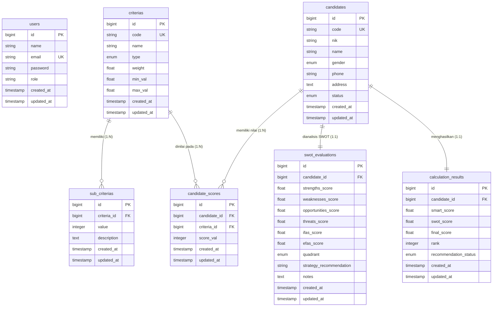

# 🛡️ Sistem Pendukung Keputusan (SPK) Penerimaan Security (SMART + SWOT)

Sistem Pendukung Keputusan (SPK) Seleksi & Penerimaan Anggota Keamanan (Security) berbasis Web menggunakan hibridisasi metode **SMART (Simple Multi-Attribute Rating Technique)** dan evaluasi **SWOT (Strengths, Weaknesses, Opportunities, Threats)**.

Aplikasi ini dirancang untuk membantu tim **HRD (Human Resource Department)** dan **Manajemen Operasional** dalam melakukan seleksi penerimaan petugas security secara obyektif, terukur, transparan, terstruktur, serta minim bias kualitatif.

---

## 📌 Daftar Isi
- [🚀 Fitur Utama & Modul Sistem](#-fitur-utama--modul-sistem)
- [🛠️ Tech Stack & Arsitektur](#️-tech-stack--arsitektur)
- [📁 Struktur Direktori Proyek](#-struktur-direktori-proyek)
- [🧮 Metodologi Perhitungan SPK (SMART + SWOT)](#-metodologi-perhitungan-spk-smart--swot)
- [📊 Skema Basis Data & Relasi Tabel (ERD)](#-skema-basis-data--relasi-tabel-erd)
- [📋 Master Data Kriteria & Sub-Kriteria Default](#-master-data-kriteria--sub-kriteria-default)
- [⚙️ Panduan Instalasi & Memulai](#️-panduan-instalasi--memulai)
- [🔑 Akun Pengguna Default (Seeder)](#-akun-pengguna-default-seeder)

---

## 🚀 Fitur Utama & Modul Sistem

1. **🔐 Authentication & Multi-Role Support**:
   - Autentikasi aman bagi Pengguna Admin dan HRD.
   - Sesi terlindungi middleware Laravel (`auth`).

2. **📊 Dashboard Analytics (`/dashboard`)**:
   - Ringkasan statistik kandidat pelamar security.
   - Indikator status penerimaan (**Diterima**, **Pertimbangan**, **Ditolak**).
   - Visualisasi distribusi kuadran evaluasi SWOT kandidat.

3. **⚙️ Manajemen Kriteria & Sub-Kriteria (`/criteria`)**:
   - Pengaturan bobot kriteria ($W_j$) secara dinamis.
   - Deskripsi indikator sub-kriteria penilaian skala Likert (skala 1–5).

4. **👤 Manajemen Pelamar / Kandidat (`/candidates`)**:
   - CRUD data calon anggota security (Kode Pelamar auto-generate `K01`, `K02`, NIK, Nama, Gender, No HP, Alamat).
   - Input nilai kriteria (skala 1–5).
   - Input skor kuantitatif komponen SWOT ($S, W, O, T$).

5. **🧮 Matriks Perhitungan SPK Transparan (`/calculation`)**:
   - Menampilkan detail matematis alur perhitungan step-by-step:
     - Normalisasi Bobot Kriteria ($w_j$).
     - Matriks Nilai Utilitas SMART ($u_i$).
     - Perhitungan Skor Matriks SWOT (IFAS & EFAS).
     - Pembobotan Kombinasi (**70% SMART + 30% SWOT**).
     - Hasil perangkingan otomatis (*Automatic Ranking*).

6. **📄 Laporan & Cetak Dokumen (`/reports` & `/reports/print`)**:
   - Rekapitulasi peringkat & rekomendasi keputusan akhir.
   - Halaman cetak laporan resmi (*Print Friendly layout*) untuk pengesahan Manajemen.

---

## 🛠️ Tech Stack & Arsitektur

* **Framework Backend**: [Laravel 11.x](https://laravel.com) (PHP >= 8.2)
* **Frontend & UI Styling**: Laravel Blade Templates, TailwindCSS, Vite Assets Bundler
* **Icons & UI Utilities**: FontAwesome / Heroicons
* **Database Engine**: MySQL / MariaDB / SQLite
* **Design Pattern**: Model-View-Controller (MVC) & Service Layer Pattern ([`SmartSwotService.php`](app/Services/SmartSwotService.php))

---

## 📁 Struktur Direktori Proyek

```text
penerimaan_security/
├── app/
│   ├── Http/
│   │   ├── Controllers/
│   │   │   ├── AuthController.php          # Handlers Login & Logout
│   │   │   ├── CalculationController.php   # Handlers Tampilan Perhitungan Transparan
│   │   │   ├── CandidateController.php     # CRUD Kandidat & Skor
│   │   │   ├── CriteriaController.php      # Pengaturan Bobot & Sub-Kriteria
│   │   │   ├── DashboardController.php     # Analytics & Ringkasan Dashboard
│   │   │   └── ReportController.php        # Handlers Rekap & Print Laporan
│   │   └── Middleware/
│   ├── Models/
│   │   ├── CalculationResult.php          # Model Rekap Perangkingan
│   │   ├── Candidate.php                  # Model Data Pelamar
│   │   ├── CandidateScore.php             # Model Skor Kriteria Candidate
│   │   ├── Criteria.php                   # Model Kriteria Penilaian
│   │   ├── SubCriteria.php                # Model Indikator Skala 1-5
│   │   ├── SwotEvaluation.php             # Model Nilai SWOT & Kuadran
│   │   └── User.php                       # Model Pengguna System
│   └── Services/
│       └── SmartSwotService.php           # Core Engine Perhitungan SMART + SWOT
├── config/                                # Konfigurasi Framework Laravel
├── database/
│   ├── migrations/                        # Skema Tabel Basis Data
│   └── seeders/
│       └── DatabaseSeeder.php             # Initial Dummy Data & Default Criteria
├── public/                                # Web Root / Compiled Assets
├── resources/
│   ├── views/                             # Template Tampilan (Blade)
│   │   ├── auth/                          # Tampilan Login
│   │   ├── calculation/                   # Tampilan Detail Perhitungan SMART-SWOT
│   │   ├── candidates/                    # Tampilan CRUD & Form Candidate
│   │   ├── criteria/                      # Tampilan Pengaturan Kriteria
│   │   ├── reports/                       # Tampilan Rekap & Print Laporan
│   │   ├── dashboard.blade.php            # Tampilan Dashboard Utama
│   │   └── layouts/                       # Main Master Layout & Navigation
├── routes/
│   └── web.php                            # Routing Web Application
├── vite.config.js                         # Konfigurasi Bundler Frontend Vite
└── composer.json                          # Dependensi PHP/Laravel
```

---

## 🧮 Metodologi Perhitungan SPK (SMART + SWOT)

Perhitungan rekomendasi kandidat dieksekusi secara terotomatisasi oleh service [`SmartSwotService`](app/Services/SmartSwotService.php) dengan alur matematis sebagai berikut:

### 1. Perhitungan Metode SMART (Bobot Pengaruh: 70%)
* **Normalisasi Bobot Kriteria ($w_j$)**:
  $$w_j = \frac{W_j}{\sum_{k=1}^{n} W_k}$$
  *Keterangan: $W_j$ adalah bobot asli kriteria ke-$j$.*

* **Nilai Utilitas SMART ($u_i$)**:
  - Untuk Kriteria Tipe **Benefit**:
    $$u_i = \frac{C_i - C_{min}}{C_{max} - C_{min}}$$
  - Untuk Kriteria Tipe **Cost**:
    $$u_i = \frac{C_{max} - C_i}{C_{max} - C_{min}}$$
  *Keterangan: $C_i$ adalah skor mentah kandidat, $C_{min}=1$, $C_{max}=5$.*

* **Total Skor SMART ($Skor_{SMART}$)**:
  $$Skor_{SMART} = \sum_{j=1}^{n} (u_j \times w_j)$$

---

### 2. Perhitungan Evaluasi SWOT (Bobot Pengaruh: 30%)
* **Skor Faktor Internal (IFAS)**: 
  $$\text{IFAS} = S - W$$
* **Skor Faktor Eksternal (EFAS)**: 
  $$\text{EFAS} = O - T$$

* **Pemetaan Kuadran Matrix SWOT & Strategi**:
  - **Kuadran SO (Agresif)** ($\text{IFAS} \ge 0, \text{EFAS} \ge 0$): Candidate Sangat Berpotensi.
  - **Kuadran ST (Diversifikasi)** ($\text{IFAS} \ge 0, \text{EFAS} < 0$): Candidate Tangguh & Berpengalaman.
  - **Kuadran WO (Turnaround)** ($\text{IFAS} < 0, \text{EFAS} \ge 0$): Candidate Memerlukan Pelatihan Khusus.
  - **Kuadran WT (Defensif)** ($\text{IFAS} < 0, \text{EFAS} < 0$): Candidate Berisiko Tinggi.

* **Normalisasi Skor SWOT (Skala 0 s/d 1)**:
  $$Skor_{SWOT} = \frac{(S + O) + (5 - W) + (5 - T)}{20}$$

---

### 3. Combination Score (Skor Akhir Keputusan)
$$Final\_Score = (0.70 \times Skor_{SMART}) + (0.30 \times Skor_{SWOT})$$

---

### 4. Matriks Keputusan Rekomendasi Penerimaan
* **Persentase Final Score $\ge 75\%$**: **Diterima** (Rekomendasi Utama)
* **Persentase Final Score $55\% - 74\%$**: **Pertimbangan** (Cadangan / Wawancara Lanjutan)
* **Persentase Final Score $< 55\%$**: **Ditolak** (Tidak Memenuhi Standar Minimal)

---

## 📊 Skema Basis Data & Relasi Tabel (ERD)

### 1. Diagram Relasi Antar Tabel (Entity Relationship Diagram - ERD)



### 📌 Penjelasan Kardinalitas Relasi Antar Tabel:
1. **`criterias` → `sub_criterias` ($1 : N$)**: Satu kriteria memiliki banyak indikator sub-kriteria (skala Likert 1–5).
2. **`criterias` → `candidate_scores` ($1 : N$)**: Satu kriteria dipetakan ke banyak transaksi penilaian kandidat.
3. **`candidates` → `candidate_scores` ($1 : N$)**: Satu kandidat memiliki 4 record penilaian kriteria (C1–C4).
4. **`candidates` → `swot_evaluations` ($1 : 1$)**: Satu kandidat memiliki tepat 1 record evaluasi kuadrat SWOT (S, W, O, T, IFAS, EFAS).
5. **`candidates` → `calculation_results` ($1 : 1$)**: Satu kandidat menghasilkan 1 record rekapitulasi nilai akhir, peringkat, dan status keputusan penerimaan.
6. **`users`**: Tabel independen untuk sistem autentikasi dan manajemen hak akses (Admin & HRD).

---

### 2. Kamus Data & Spesifikasi Tabel (Database Data Dictionary)

#### Tabel 1: `users`
* **Nama Tabel**: `users`
* **Fungsi**: Menyimpan data akun pengguna sistem (Pengelola/Admin dan Tim HRD) untuk autentikasi dan hak akses.
* **Primary Key**: `id`

| No | Nama Field (Attribute) | Tipe Data | Constraint / Kunci | Keterangan / Deskripsi |
|---|---|---|---|---|
| 1 | `id` | `BIGINT` | `PK`, `Auto Increment` | Identitas unik pengguna |
| 2 | `name` | `VARCHAR(255)` | `Not Null` | Nama lengkap pengguna sistem |
| 3 | `email` | `VARCHAR(255)` | `Unique`, `Not Null` | Alamat email (digunakan untuk login) |
| 4 | `email_verified_at` | `TIMESTAMP` | `Nullable` | Waktu verifikasi email pengguna |
| 5 | `password` | `VARCHAR(255)` | `Not Null` | Kata sandi terenkripsi (Hash) |
| 6 | `role` | `VARCHAR(255)` | `Default: 'admin'` | Hak akses pengguna (`admin` / `hrd`) |
| 7 | `remember_token` | `VARCHAR(100)` | `Nullable` | Token sesi "remember me" |
| 8 | `created_at` | `TIMESTAMP` | `Nullable` | Waktu data dibuat |
| 9 | `updated_at` | `TIMESTAMP` | `Nullable` | Waktu data terakhir diperbarui |

---

#### Tabel 2: `criterias`
* **Nama Tabel**: `criterias`
* **Fungsi**: Menyimpan data master kriteria penilaian seleksi beserta bobot awal ($W_j$) dan jenis kriteria.
* **Primary Key**: `id`

| No | Nama Field (Attribute) | Tipe Data | Constraint / Kunci | Keterangan / Deskripsi |
|---|---|---|---|---|
| 1 | `id` | `BIGINT` | `PK`, `Auto Increment` | Identitas unik kriteria |
| 2 | `code` | `VARCHAR(255)` | `Unique`, `Not Null` | Kode kriteria penilaian (misal: C1, C2, C3, C4) |
| 3 | `name` | `VARCHAR(255)` | `Not Null` | Nama kriteria (Integritas, Kesehatan Fisik, dll) |
| 4 | `type` | `ENUM('benefit', 'cost')` | `Default: 'benefit'` | Sifat kriteria (`benefit` / `cost`) |
| 5 | `weight` | `FLOAT` | `Not Null` | Nilai bobot kriteria ($W_j$) dalam % |
| 6 | `min_val` | `FLOAT` | `Default: 1.0` | Nilai minimum indikator kriteria ($C_{min}$) |
| 7 | `max_val` | `FLOAT` | `Default: 5.0` | Nilai maksimum indikator kriteria ($C_{max}$) |
| 8 | `created_at` | `TIMESTAMP` | `Nullable` | Waktu data dibuat |
| 9 | `updated_at` | `TIMESTAMP` | `Nullable` | Waktu data terakhir diperbarui |

---

#### Tabel 3: `sub_criterias`
* **Nama Tabel**: `sub_criterias`
* **Fungsi**: Menyimpan parameter indikator skala nilai 1 s/d 5 untuk setiap kriteria penilaian.
* **Primary Key**: `id`
* **Foreign Key**: `criteria_id` (relasi ke `criterias.id`)

| No | Nama Field (Attribute) | Tipe Data | Constraint / Kunci | Keterangan / Deskripsi |
|---|---|---|---|---|
| 1 | `id` | `BIGINT` | `PK`, `Auto Increment` | Identitas unik sub-kriteria |
| 2 | `criteria_id` | `BIGINT` | `FK`, `On Delete Cascade` | Relasi ke ID Kriteria (`criterias.id`) |
| 3 | `value` | `INT` | `Not Null` | Skala nilai indikator (1, 2, 3, 4, atau 5) |
| 4 | `description` | `TEXT` | `Not Null` | Deskripsi kualitatif indikator penilaian |
| 5 | `created_at` | `TIMESTAMP` | `Nullable` | Waktu data dibuat |
| 6 | `updated_at` | `TIMESTAMP` | `Nullable` | Waktu data terakhir diperbarui |

---

#### Tabel 4: `candidates`
* **Nama Tabel**: `candidates`
* **Fungsi**: Menyimpan biodata lengkap kandidat/pelamar anggota security.
* **Primary Key**: `id`

| No | Nama Field (Attribute) | Tipe Data | Constraint / Kunci | Keterangan / Deskripsi |
|---|---|---|---|---|
| 1 | `id` | `BIGINT` | `PK`, `Auto Increment` | Identitas unik pelamar/kandidat |
| 2 | `code` | `VARCHAR(255)` | `Unique`, `Not Null` | Kode unik kandidat (misal: K01, K02, dst) |
| 3 | `nik` | `VARCHAR(255)` | `Nullable` | Nomor Induk Kependudukan (NIK) pelamar |
| 4 | `name` | `VARCHAR(255)` | `Not Null` | Nama lengkap pelamar |
| 5 | `gender` | `ENUM('L', 'P')` | `Default: 'L'` | Jenis kelamin (`L` = Laki-laki, `P` = Perempuan) |
| 6 | `phone` | `VARCHAR(255)` | `Nullable` | Nomor telepon / WhatsApp pelamar |
| 7 | `address` | `TEXT` | `Nullable` | Alamat domisili pelamar |
| 8 | `status` | `ENUM('Draft', 'Evaluated')` | `Default: 'Draft'` | Status evaluasi kandidat |
| 9 | `created_at` | `TIMESTAMP` | `Nullable` | Waktu data dibuat |
| 10 | `updated_at` | `TIMESTAMP` | `Nullable` | Waktu data terakhir diperbarui |

---

#### Tabel 5: `candidate_scores`
* **Nama Tabel**: `candidate_scores`
* **Fungsi**: Menyimpan skor mentah kriteria (skala 1–5) yang diperoleh oleh setiap kandidat.
* **Primary Key**: `id`
* **Foreign Keys**: `candidate_id` (relasi ke `candidates.id`), `criteria_id` (relasi ke `criterias.id`)

| No | Nama Field (Attribute) | Tipe Data | Constraint / Kunci | Keterangan / Deskripsi |
|---|---|---|---|---|
| 1 | `id` | `BIGINT` | `PK`, `Auto Increment` | Identitas unik record skor kriteria |
| 2 | `candidate_id` | `BIGINT` | `FK`, `On Delete Cascade` | Relasi ke ID Kandidat (`candidates.id`) |
| 3 | `criteria_id` | `BIGINT` | `FK`, `On Delete Cascade` | Relasi ke ID Kriteria (`criterias.id`) |
| 4 | `score_val` | `INT` | `Not Null` | Nilai skor kriteria kandidat (Skala 1 s/d 5) |
| 5 | `created_at` | `TIMESTAMP` | `Nullable` | Waktu data dibuat |
| 6 | `updated_at` | `TIMESTAMP` | `Nullable` | Waktu data terakhir diperbarui |

---

#### Tabel 6: `swot_evaluations`
* **Nama Tabel**: `swot_evaluations`
* **Fungsi**: Menyimpan skor evaluasi faktor internal (Strengths, Weaknesses) dan eksternal (Opportunities, Threats) serta hasil perhitungan IFAS, EFAS, kuadran, dan rekomendasi strategi SWOT.
* **Primary Key**: `id`
* **Foreign Key**: `candidate_id` (relasi ke `candidates.id`)

| No | Nama Field (Attribute) | Tipe Data | Constraint / Kunci | Keterangan / Deskripsi |
|---|---|---|---|---|
| 1 | `id` | `BIGINT` | `PK`, `Auto Increment` | Identitas unik evaluasi SWOT |
| 2 | `candidate_id` | `BIGINT` | `FK`, `On Delete Cascade` | Relasi ke ID Kandidat (`candidates.id`) |
| 3 | `strengths_score` | `FLOAT` | `Default: 3.0` | Skor Kekuatan / *Strengths* ($S$) |
| 4 | `weaknesses_score` | `FLOAT` | `Default: 2.0` | Skor Kelemahan / *Weaknesses* ($W$) |
| 5 | `opportunities_score`| `FLOAT` | `Default: 4.0` | Skor Peluang / *Opportunities* ($O$) |
| 6 | `threats_score` | `FLOAT` | `Default: 2.0` | Skor Ancaman / *Threats* ($T$) |
| 7 | `ifas_score` | `FLOAT` | `Default: 0.0` | Nilai IFAS ($S - W$) |
| 8 | `efas_score` | `FLOAT` | `Default: 0.0` | Nilai EFAS ($O - T$) |
| 9 | `quadrant` | `ENUM('SO', 'ST', 'WO', 'WT')` | `Default: 'SO'` | Kuadran matriks SWOT |
| 10 | `strategy_recommendation` | `VARCHAR(255)` | `Nullable` | Teks rekomendasi strategi SWOT |
| 11 | `notes` | `TEXT` | `Nullable` | Catatan penilai / tim HRD |
| 12 | `created_at` | `TIMESTAMP` | `Nullable` | Waktu data dibuat |
| 13 | `updated_at` | `TIMESTAMP` | `Nullable` | Waktu data terakhir diperbarui |

---

#### Tabel 7: `calculation_results`
* **Nama Tabel**: `calculation_results`
* **Fungsi**: Menyimpan rekapitulasi hasil perhitungan skor SMART, skor SWOT, *Combination Score* (Nilai Akhir), peringkat (*rank*), dan keputusan akhir penerimaan.
* **Primary Key**: `id`
* **Foreign Key**: `candidate_id` (relasi ke `candidates.id`)

| No | Nama Field (Attribute) | Tipe Data | Constraint / Kunci | Keterangan / Deskripsi |
|---|---|---|---|---|
| 1 | `id` | `BIGINT` | `PK`, `Auto Increment` | Identitas unik hasil perangkingan |
| 2 | `candidate_id` | `BIGINT` | `FK`, `On Delete Cascade` | Relasi ke ID Kandidat (`candidates.id`) |
| 3 | `smart_score` | `FLOAT` | `Default: 0.0` | Total Skor SMART ($0.0 - 1.0$) |
| 4 | `swot_score` | `FLOAT` | `Default: 0.0` | Total Skor Ter-normalisasi SWOT ($0.0 - 1.0$) |
| 5 | `final_score` | `FLOAT` | `Default: 0.0` | Skor Kombinasi Akhir ($0.70 \times SMART + 0.30 \times SWOT$) |
| 6 | `rank` | `INT` | `Default: 0` | Peringkat kandidat hasil perangkingan |
| 7 | `recommendation_status` | `ENUM('Diterima', 'Pertimbangan', 'Ditolak')` | `Default: 'Pertimbangan'` | Keputusan penerimaan kandidat |
| 8 | `created_at` | `TIMESTAMP` | `Nullable` | Waktu data dibuat |
| 9 | `updated_at` | `TIMESTAMP` | `Nullable` | Waktu data terakhir diperbarui |

---

## 📋 Master Data Kriteria & Sub-Kriteria Default

| Kode | Kriteria Penilaian | Tipe | Bobot Awal | Skala Nilai (1–5) & Indikator Penilaian |
|---|---|---|---|---|
| **C1** | Integritas (Catatan Kriminal / SKCK) | Benefit | 30% | 1: Kasus Berat<br>2: Kasus Ringan<br>3: Tanpa Catatan (Belum SKCK)<br>4: SKCK Bersih<br>5: SKCK Bersih + Referensi Institusi |
| **C2** | Kesehatan Fisik & Tes Fisik | Benefit | 25% | 1: Ada Penyakit Berat / Tidak Layak<br>2: Kurang Prima<br>3: Sehat (Belum MCU)<br>4: Sehat MCU<br>5: Sehat Prima + Lulus Tes Fisik |
| **C3** | Pengalaman Kerja Security | Benefit | 25% | 1: Tanpa Pengalaman<br>2: < 1 Tahun<br>3: 1–2 Tahun<br>4: 3–5 Tahun<br>5: > 5 Tahun / Perkantoran & Mall |
| **C4** | Kesiapan Shift & Fleksibilitas | Benefit | 20% | 1: Tidak Fleksibel<br>2: 2 Shift (Kendala Transpor)<br>3: Bisa Semua Shift (Belum Terbukti)<br>4: Bisa Semua Shift (Domisili Dekat)<br>5: Siap Shift Malam & Pengalaman Shift |

---

## ⚙️ Panduan Instalasi & Memulai

### Prasyarat Sistem
* **PHP** >= 8.2 (ekstensi `pdo_mysql`, `mbstring`, `openssl`, `bcmath`, `gd` aktif)
* **Composer** (v2.x)
* **Node.js** (v18.x / v20.x) & **NPM**
* **Database Server**: MySQL 8.0+ / MariaDB 10.4+ / SQLite

---

### Langkah-Langkah Setup Local Environment

1. **Clone Repositori Proyek**:
   ```bash
   git clone <repository_url>
   cd penerimaan_security
   ```

2. **Install Dependensi Composer & NPM**:
   ```bash
   composer install
   npm install
   ```

3. **Konfigurasi Environment File (`.env`)**:
   Salin `.env.example` menjadi `.env`:
   ```bash
   cp .env.example .env
   ```
   Atur koneksi database pada `.env`:
   ```env
   DB_CONNECTION=mysql
   DB_HOST=127.0.0.1
   DB_PORT=3306
   DB_DATABASE=penerimaan_security
   DB_USERNAME=root
   DB_PASSWORD=
   ```

4. **Generate App Key, Migrasi & Seed Database**:
   ```bash
   php artisan key:generate
   php artisan migrate:fresh --seed
   ```

5. **Jalankan Application Server & Asset Compiler**:
   - Terminal 1 (Laravel Local Server):
     ```bash
     php artisan serve
     ```
   - Terminal 2 (Vite Compiler):
     ```bash
     npm run dev
     ```

6. **Akses Aplikasi melalui Browser**:
   Buka URL: `http://127.0.0.1:8000`

---

## 🔑 Akun Pengguna Default (Seeder)

Gunakan akun seeder berikut untuk melakukan pengujian sistem:

| Email | Password | Peran (Role) | Hak Akses |
|---|---|---|---|
| `admin@sentraniaga.com` | `password` | Administrator | Full Access (Kelola User, Kriteria, Candidate, Perhitungan, Laporan) |
| `hrd@sentraniaga.com` | `password` | Tim HRD | HR Access (Kelola Candidate, Input Evaluasi, Perhitungan, Cetak Laporan) |

---

## 📄 Lisensi
Sistem Pendukung Keputusan (SPK) Penerimaan Security ini dikembangkan untuk mengoptimalkan proses seleksi anggota keamanan yang obyektif dan akurat.
